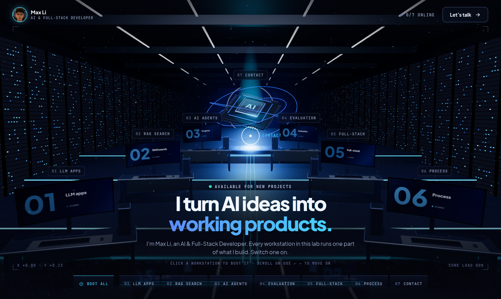

# AI & Full-Stack Developer · 3D portfolio

**Live: https://solutionstackhub-jpg.github.io/ai-portfolio-3d/**

A one-screen portfolio built as a 3D lab with Three.js. Plain HTML, CSS and JavaScript, no build step.



A dark hall: a mirror-black floor, a stage that climbs in three steps to a floating processor marked
"AI", server racks down both walls, light strips overhead running to a ring of light at the far end.
Workstations stand in two wings along the aisle; each one is a topic. Click one: it boots, its
curved display runs a small animation, its keyboard and tower light up, a hologram rises above it,
the camera flies in and a text window unfolds beside it. The core at the top of the steps is the
contact point.

## Run

Browsers do not load JavaScript modules from `file://`, so serve the folder:

```bash
python3 serve.py
```

Then open http://localhost:5180

Use `serve.py` instead of `python3 -m http.server`: it makes the browser check for newer files on
every load. With the plain server a browser can keep running scripts it saved earlier for an hour
or more after you change them, and the page breaks or shows the old version.

## Change the content

All text is in `src/content.js`.

- `name`, `role`, `photo` – shown at the top left and in the contact window. The photo is a square
  image in `images/`; it is displayed round. Leave `name` empty to show only the role. If you
  change the name, change the `<title>` and description at the top of `index.html` too.
- `machines` – one entry per thing you can open. Entries become workstations, split between the
  two wings in order (the design holds six; eight at most). Each has a `label`, a `title`, `text`,
  `points` (text before a colon is shown in bold), `tags`, and a `screen` that picks what its
  display shows and which hologram floats above it: `chat`, `search`, `agents`, `gauge`, `stack`,
  `steps` or `mail`.
- The entry marked `core: true` is the AI core instead of a workstation. It carries the `email` that
  the contact button writes to. The "Let's talk" button opens it.

## Using it

- Click a workstation, its label, or its name in the bottom bar. The mouse wheel walks through
  them in order, `←` `→` move between them, `Esc` returns to the hall. "Boot all" switches
  everything on.
- The mouse drives the room: the camera leans with it, the displays turn to watch it, a pool of
  light and rings follow it across the floor, the headline's letters rise under it, and a ring
  that trails the pointer says what a click will do. While the pointer rests on the text window the room holds still.
- On a phone there is one workstation in front of you at a time: swipe sideways or use the bar,
  tap to boot; the text comes up as a sheet.

## Files

- `index.html` – page shell and the import map that points `three` at `vendor/`
- `serve.py` – the small web server described above

In `src/`:

- `content.js` – every word on the page
- `main.js` – builds the page, the unfolding text window, the bar, keyboard, wheel and cursor
- `scene.js` – the 3D lab: hall, mirror floor, core, workstations, lighting, camera, mouse effects
- `screens.js` – what each workstation's display shows (drawn with the 2D canvas API)
- `fx.js` – the headline as solid 3D letters
- `studio.js` – colours, the reflections glossy surfaces pick up, and the choice of drawing mode
- `style.css` – layout and visual design

Elsewhere:

- `images/avatar.jpg` – the profile photo
- `fonts/jakarta-800.json` – outlines of the heading font (Plus Jakarta Sans ExtraBold), used to build
  the 3D letters; `fonts/OFL.txt` is that font's licence
- `vendor/three/` – Three.js 0.186.1 (only the files this page imports)
- `.nojekyll` – tells GitHub Pages to serve the files exactly as they are

## Notes

- Two ways of drawing, chosen when the page loads:
  - **full** – through a wide-range buffer with bloom, shadows and studio reflections on every
    glossy surface. Picked for dedicated graphics cards (NVIDIA, Radeon RX/Pro, Intel Arc, Apple).
  - **lite** – straight to the screen, without those three. Picked for laptop graphics, phones
    and anything not recognised. In a software test it drew a frame about 2.6 times faster.

  The `FX · FULL / LITE` button in the top bar switches between them and remembers the choice;
  `?full` or `?lite` in the address does the same for one visit.
- In either mode the page watches its own pace and, when frames average under about 40 a second,
  gives things up one at a time: sharpness, then (full) bloom, then the size of the floor's mirror
  image, down to no mirror at all. `?hold` switches this off, `?dpr=1` fixes the sharpness and
  `?mirror=0` removes the mirror.
- What keeps it light: three moving lights instead of one per desk (the other displays use
  painted-on glow), shadows drawn once instead of every frame, small objects left out of the
  mirror, no blur-behind effects in the interface, and a system pointer that is never hidden.
- Without WebGL the page shows the same text as a plain scrolling list.
- The lines shown on the workstations' displays (sample questions, file names) are illustrations.
- Credits: [Three.js](https://threejs.org), MIT licence (see `vendor/three/LICENSE`). Fonts: Plus Jakarta
  Sans and JetBrains Mono, SIL Open Font Licence; the web fonts load from Google Fonts.
